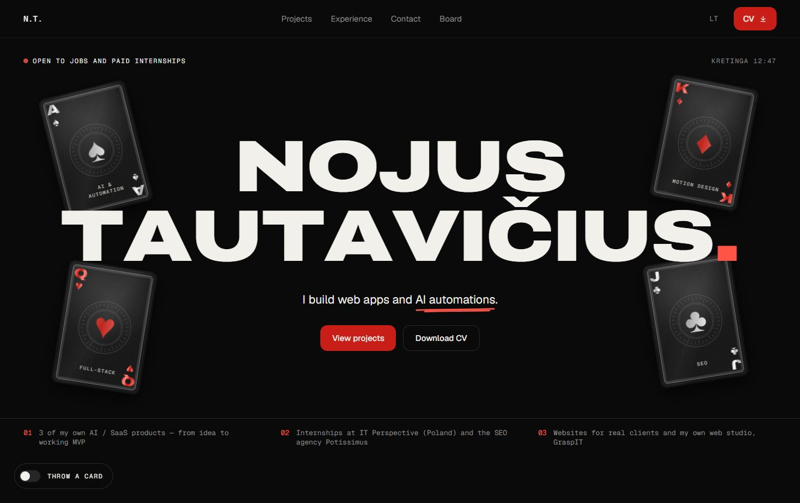

# Portfolio — Nojus Tautavičius

My personal site: projects, experience and a CV that is generated from the same data as the site.
Lithuanian and English.

**Live:** [ntdev.lt](https://ntdev.lt)



## What's inside

- **Hero deck.** Four playing cards (AI, full-stack, motion, SEO) built with plain CSS 3D transforms, no WebGL.
  Hover tilts them, click flips them.
- **Card thrower.** Toggle in the bottom-left corner: aim and throw cards at the page. They tumble, stick and
  crack the screen.
- **Pinned projects section** on desktop (GSAP ScrollTrigger + Lenis smooth scroll); mobile and reduced motion
  get a plain list.
- **Project board** (`/en/projects`): an infinite, draggable canvas that wraps around in both directions.
- **CV from the same content.** `/[locale]/cv` is a print layout; `npm run cv` opens it in headless Chrome and
  saves a one-page PDF per language, warning if one spills onto a second page.
- **i18n** with `next-intl`: `/lt/...` and `/en/...`, including translated URLs (`/lt/projektai` →
  `/en/projects`).

Lighthouse: desktop 99–100, mobile ~90, accessibility 100. axe-core reports 0 violations.

## Stack

Next.js 16 (App Router) · TypeScript · Tailwind CSS 4 · next-intl · GSAP · Lenis · Playwright (CV PDFs) ·
Vercel

## Structure

```
src/
  app/[locale]/        pages: home, project pages, board, CV
  content/             all text and project data (one place for site + CV)
  components/deck/     hero cards
  components/thrower/  card thrower + crack effect
  components/board/    infinite project board
  messages/            UI strings (lt, en)
scripts/generate-cv.mjs
```

## Run locally

```bash
npm install
npm run dev          # http://localhost:3000
npm run cv           # with the server running: regenerates public/cv/*.pdf
```

Optional `.env.local`: `CV_PHONE` (printed only in the PDF), `SITE_URL`.
